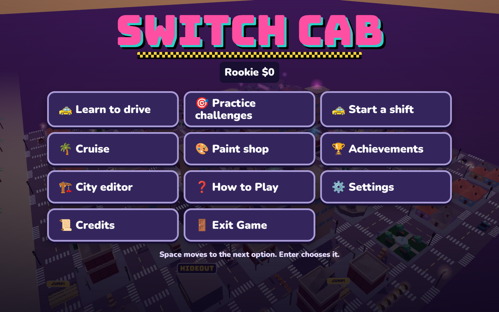
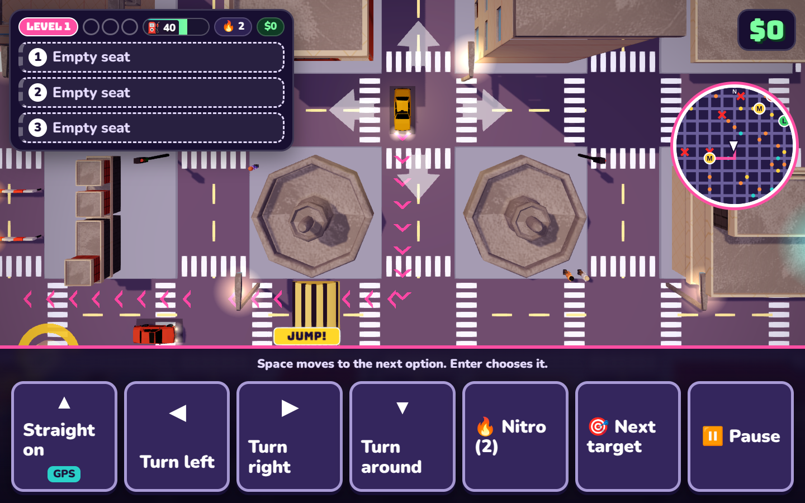
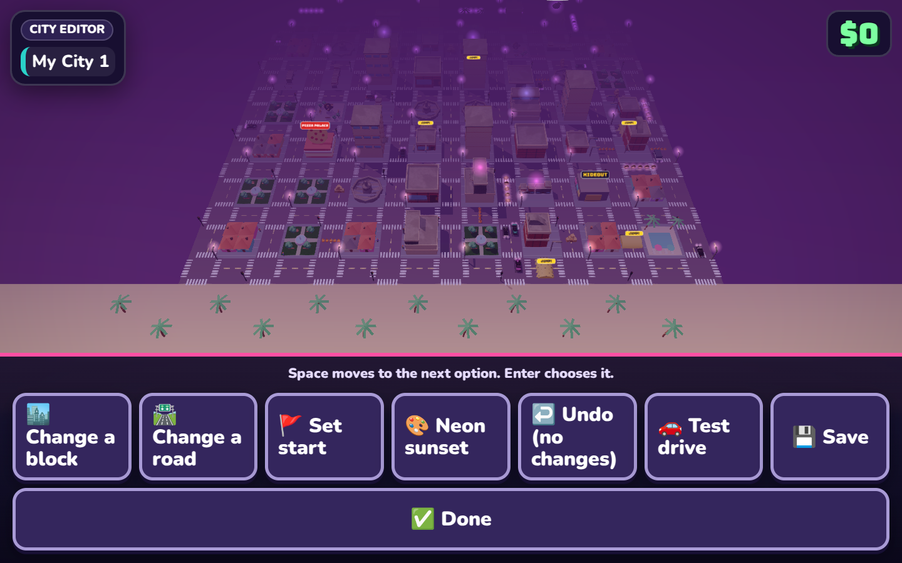
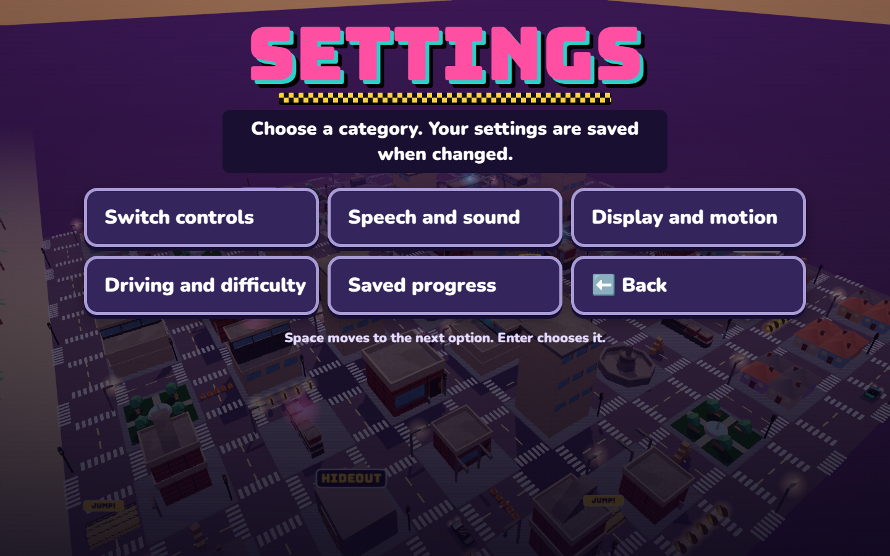

# Switch Cab v1.0

**A free, switch-accessible 3D taxi game. Drive at your own pace.**

[Play Switch Cab](https://southernadd-cmyk.github.io/taxi/) · [Report a problem or suggest an improvement](https://github.com/southernadd-cmyk/taxi/issues)

Switch Cab is a browser-based driving game designed for people who use one or two accessibility switches. Pick up passengers, plan routes, earn fares, dodge the police and explore a colourful city. There are no real-time driving deadlines: the world advances when you choose to move.

Version 1.0 is the first feature-complete edition. Further updates will focus on real-world player feedback, accessibility and reliability.

## Screenshots

Captured directly from the v1.0 game in a desktop browser.

| Main menu | Driving |
| --- | --- |
|  |  |
| **City editor** | **Accessibility settings** |
|  |  |

## How to play

| Input mode | Move between choices | Select |
| --- | --- | --- |
| One switch (automatic scanning) | Choices highlight automatically | Enter |
| Two switches (manual scanning) | Space | Enter |
| Mouse or touch | — | Click or tap a choice |

The game accepts switches configured to send Space and Enter. Choose **Learn to drive** to practise a passenger pickup and drop-off with no police, fuel costs or penalties. Then start a shift, take on a challenge or cruise freely.

At a junction, choose a direction or follow the GPS. Each move advances the other cars, passenger patience and fuel by a turn. There is no need to steer continuously or react quickly. In one-switch mode the car waits for the player at junctions.

## What you can do

- **Taxi shift:** pick up and deliver passengers, manage fuel, passenger patience and three seats, earn fares and progress through increasingly busy cities.
- **Cruise:** explore at your own pace, collect coins and discover stunt opportunities.
- **Daily challenge:** play a shared daily city and fare challenge and improve your personal record.
- **Practice:** learn the basics, then practise carpooling, stunts and police evasion separately.
- **Dares and stunts:** passengers can offer optional challenges for extra rewards; use ramps, coins and nitro.
- **Progress:** earn money, unlock achievements and buy new taxi colours in the paint shop.
- **City editor:** build or adapt a city, undo edits, save it and test-drive it without affecting your normal progress. Sharing codes requires a mouse and keyboard.

## Accessibility

Switch Cab is designed around player-controlled pace, not reaction time. Settings are accessible through scanning and saved on the device.

| Feature | What it does |
| --- | --- |
| Switch scanning | Automatic or manual scanning, adjustable intervals, speech-aware timing, parking and braking |
| Spoken information | Announces menus, choices and gameplay; Game information reads out fuel, passengers, directions, hazards and progress |
| Voice | One device speech voice throughout, with a preference for available natural British English voices; player-selectable voice and speech toggle |
| Visual access | Large text, high-contrast selection, simplified driving HUD and optional outlines |
| Motion and sound | Reduced-motion mode, steady police lights, north-up minimap option, independent music, engine and sound-effect controls |
| Difficulty | Relaxed, Normal and Tough passenger settings; adjustable vehicle speed and police behaviour |
| Safe navigation | Confirmations for destructive actions, purchases, resets and replacing a saved ride; retained selection when returning to menus |

Reduced motion follows the device preference unless explicitly enabled. It uses a stable camera and minimap, steady effects and removes unnecessary animation without changing scoring or choices.

Accessibility is an ongoing commitment, not a claim of formal certification. Feedback from switch users, families, educators and assistive technology specialists is welcome.

## Benny’s Hub integration

Switch Cab supports the shared platform, scan controller, voice manager and SafeAudio modules used by Benny’s Hub when installed under `/bennyshub/`. The Hub's voice preferences (voice, rate, pitch, volume and speech enabled state) and scanning settings remain authoritative. Standalone play uses local preferences instead.

The game is independently available on GitHub Pages; inclusion in Benny’s Hub is a separate decision by its maintainers.

For Hub deployment, copy the game directory into `bennyshub/apps/games/SWITCHCAB/`, preserving `js/`, `assets/` and the HTML entry point, then register the game through the Hub's normal process. Cross-origin browser storage cannot share settings with the Hub.

## Run locally

No build step is required. Serve the repository over HTTP so the 3D models can load:

```sh
python3 -m http.server 8000
```

Open http://localhost:8000 in a browser with WebGL support. GitHub Pages also works directly.

## Project details

Switch Cab uses HTML, CSS, JavaScript and Three.js. The source separates the scanning and speech system, city rendering, turn simulation, progression, settings and editor. Automated regression tests cover the input contract, speech waiting, navigation, practice, editor and gameplay. A browser acceptance test is also available on demand.

See [CREDITS.md](CREDITS.md) for model and library attribution and [LICENSE.txt](LICENSE.txt) for licensing.

## Feedback

If something prevents you from playing, please [open an issue](https://github.com/southernadd-cmyk/taxi/issues). If possible, include your device, browser, switch setup and the screen or action where the problem occurred.
